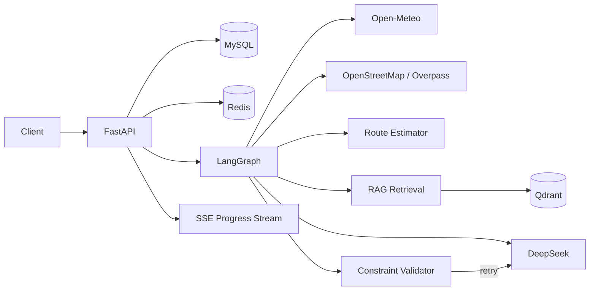

# Travel Planning Agent API

一个面向旅行规划场景的后端项目。它使用 FastAPI 提供 API，使用 LangGraph 编排多步骤生成流程，结合实时天气、OpenStreetMap 景点、路线估算、Qdrant 旅游知识库和 DeepSeek，生成带来源、可校验、可追踪、可恢复的旅行计划。

## 项目亮点

- **不是一次普通的 LLM 调用**：天气、景点、路线、RAG、生成和校验被拆成独立节点。
- **生成结果可约束**：检查天数、日期、预算、活动数量、费用合计、时间顺序、天气适配和通勤时间，不合格时定向重试生成节点。
- **知识来源可解释**：Qdrant 向量召回叠加关键词覆盖度重排，答案和计划保留引用片段。
- **执行过程可观察**：支持同步生成、SSE 流式进度、Redis 状态、MySQL 执行记录和失败原因。
- **结果可追溯**：每次成功生成都会保存计划版本，可以查询历史并恢复旧版本。
- **工程化可交付**：Alembic 管理数据库结构，Docker Compose 启动完整依赖，pytest 和 GitHub Actions 提供回归保障。
- **个人账号与空间隔离**：个人注册登录使用可撤销 Bearer 会话；服务端仍可用 API Key，旅行与知识文档按空间隔离。

## 系统架构



LangGraph 主流程：

```text
weather -> attractions -> route -> knowledge -> generate_plan -> validate_plan
                                                        ^              |
                                                        |---- retry ---|
```

每个工具节点只负责一种外部信息，生成节点负责把结构化上下文交给模型，校验节点负责判断计划是否可执行。校验失败时不会重复调用全部外部服务，而是把错误反馈给生成节点重试，减少延迟和外部请求。

## 功能范围

- 旅行记录 CRUD、筛选和分页
- Open-Meteo 天气查询与缓存
- OpenStreetMap / Overpass 景点检索、备用节点和超时容错
- 基于 Haversine 距离的近邻路线排序、交通方式和时间估算
- TXT、Markdown、PDF 文档解析、切分和 Qdrant 向量检索
- 多语言 FastEmbed 向量模型、查询改写和关键词二阶段重排
- DeepSeek 结构化计划生成、Pydantic 校验和失败重试
- 同步生成、SSE 节点进度、任务状态查询
- Redis 缓存与任务状态；Redis 不可用时回退到内存和文件缓存
- MySQL 计划版本、历史恢复、执行记录和失败审计
- 个人账号注册、登录、退出和 24 小时可撤销会话
- Alembic 迁移、Docker Compose 和自动化测试

## Docker 快速启动

要求 Docker Desktop 已启动，并使用 Linux 容器。

### 从旧版本升级

如果从最初、尚无客户空间的版本升级且数据库中已有旅行记录，先备份 MySQL 和 Qdrant，并在 `.env` 设置至少 32 字符的随机 `LEGACY_TENANT_API_KEY`。迁移会把旧旅行记录归入 `legacy` 空间。已经完成客户空间迁移的数据库升级个人账号表时，不需要重新设置该密钥。

旧 Qdrant 文档没有客户空间标记，升级后不会出现在任何客户的检索结果中。使用对应客户密钥重新上传文档；旧向量需要由管理员在确认备份后清理。

```powershell
if (-not (Test-Path .env)) { Copy-Item .env.example .env }
```

编辑 `.env`，至少填写 `DB_PASSWORD`、`MYSQL_ROOT_PASSWORD` 和 `DEEPSEEK_API_KEY`。如果容器必须经过 Windows 主机上的代理访问外网，再取消下面配置的注释并按实际端口修改：

```dotenv
OUTBOUND_PROXY=http://host.docker.internal:7897
```

启动并检查服务：

```powershell
docker compose up -d --build
docker compose ps
docker compose logs -f api
```

创建一个客户空间。密钥只在创建时输出一次，请妥善保存；轮换密钥会立即使旧密钥失效。

```powershell
docker compose exec api python -m scripts.manage_tenants create demo
docker compose exec api python -m scripts.manage_tenants rotate 1
```

服务端集成仍可使用 `X-API-Key` 请求头。在 Swagger UI 中点击 **Authorize** 填入密钥。PowerShell 示例：

```powershell
$apiKey = "<创建客户空间时输出的密钥>"
$headers = @{ "X-API-Key" = $apiKey }
Invoke-RestMethod http://127.0.0.1:8000/trips -Headers $headers
```

个人用户使用 `POST /auth/register` 注册（密码至少 12 字符），再通过 `POST /auth/login` 获取 24 小时有效的随机会话令牌。调用旅行和知识库接口时发送 `Authorization: Bearer <access_token>`；`GET /auth/me` 查询当前账号，`POST /auth/logout` 可立即撤销当前会话。注册时自动创建个人专属空间，不向用户暴露空间 API Key。令牌只在登录响应中显示，数据库只保存哈希。

认证入口采用固定时间窗限流：同一来源地址每小时最多尝试注册 5 次；登录同一账号每 15 分钟最多尝试 10 次，同一来源地址最多尝试 50 次。超过限制返回 `429` 与 `Retry-After`。配置 `REDIS_URL` 时计数在 Redis 中跨 API 实例共享；Redis 故障时认证入口返回 `503`，不会退回到不共享的本地计数。未配置 Redis 时仅使用进程内计数，适合单实例本地开发，不适合公开多实例部署。来源地址取应用看到的连接地址，不直接信任客户端提交的转发头；部署在代理之后时需在网关正确配置可信代理和额外防护。

```powershell
$securePassword = Read-Host "Password" -AsSecureString
$account = @{ email = "alice@example.com"; password = [System.Net.NetworkCredential]::new("", $securePassword).Password }
Invoke-RestMethod http://127.0.0.1:8000/auth/register -Method Post -ContentType "application/json" -Body ($account | ConvertTo-Json)
$session = Invoke-RestMethod http://127.0.0.1:8000/auth/login -Method Post -ContentType "application/json" -Body ($account | ConvertTo-Json)
$userHeaders = @{ Authorization = "Bearer $($session.access_token)" }
Invoke-RestMethod http://127.0.0.1:8000/trips -Headers $userHeaders
```

上述命令仅用于本地开发演示；公开部署前必须通过 HTTPS 传输密码和令牌，也不要把会话令牌截图或提交到 Git。

- Swagger UI: <http://127.0.0.1:8000/docs>
- Health check: <http://127.0.0.1:8000/health>

API 容器启动时会先执行 `alembic upgrade head`。首次使用知识库时会下载约 220 MB 的多语言嵌入模型并保存到 Docker volume。

普通停止不会删除数据：

```powershell
docker compose down
```

`docker compose down -v` 会删除 MySQL、Redis、Qdrant 和模型缓存卷，只应在明确需要清空数据时执行。

## 本地开发

要求 Python 3.12 和已启动的 MySQL 8。Qdrant、Redis 都是可选的：没有远程 Qdrant 时可以使用本地路径，没有 Redis 时缓存自动降级。

```powershell
conda create --prefix .\.venv python=3.12 pip -y
.\.venv\python.exe -m pip install -r requirements-dev.txt
if (-not (Test-Path .env)) { Copy-Item .env.example .env }
.\.venv\python.exe -m alembic upgrade head
.\.venv\python.exe -m scripts.manage_tenants create demo
.\.venv\python.exe -m uvicorn app.main:app --reload
```

## 推荐演示流程

1. `POST /trips` 创建旅行记录。
2. `POST /knowledge/documents` 上传该城市的旅游资料。
3. `GET /knowledge/search` 查看检索和重排结果。
4. `POST /knowledge/ask` 演示查询改写、回答和引用来源。
5. `POST /trips/{trip_id}/generate-plan/stream` 观察 SSE 节点进度。
6. `GET /trips/{trip_id}/plans` 查看计划版本。
7. `GET /trips/{trip_id}/executions` 查看同步/流式执行记录和失败原因。
8. `POST /trips/{trip_id}/plans/{version}/restore` 演示版本恢复。

规划进行中，恢复、编辑、删除旅行会返回 409。旅行状态由服务端管理；`PATCH /trips/{trip_id}/status` 只允许重置为 `draft`。

知识库上传示例：

```powershell
curl.exe -X POST http://127.0.0.1:8000/knowledge/documents `
  -H "X-API-Key: $apiKey" `
  -F "file=@.\knowledge\chengdu.md" `
  -F "city=成都"
```

SSE 调用示例：

```powershell
curl.exe -N -X POST http://127.0.0.1:8000/trips/1/generate-plan/stream -H "X-API-Key: $apiKey"
```

完整的讲解顺序、演示命令和高频问答见 [面试演示手册](docs/INTERVIEW_GUIDE.md)。

## 数据库迁移

```powershell
.\.venv\python.exe -m alembic current
.\.venv\python.exe -m alembic upgrade head
.\.venv\python.exe -m alembic check
```

修改 SQLAlchemy 模型后，先生成迁移并检查脚本，再升级数据库：

```powershell
.\.venv\python.exe -m alembic revision --autogenerate -m "describe change"
.\.venv\python.exe -m alembic upgrade head
```

## 测试与评估

```powershell
.\.venv\python.exe -m pytest -q
```

自动化测试使用隔离数据库并 mock 大模型和外部服务，不依赖真实 MySQL、Redis、Qdrant、天气或地图接口。GitHub Actions 会对每次 push 和 pull request 执行相同测试。

RAG 检索评估：

```powershell
.\.venv\python.exe -m scripts.evaluate_rag --tenant-id 1
```

完整工作流评估会调用真实天气、景点、RAG 和大模型服务，因此会产生外部请求：

```powershell
.\.venv\python.exe -m scripts.evaluate --tenant-id 1 --limit 5
```

结果写入 `reports/evaluation.json`。简历中的成功率和延迟指标应以最新真实报告为准。

## 配置项

| Variable | Purpose |
| --- | --- |
| `DB_*` | MySQL 连接配置 |
| `DB_ECHO` | 是否输出 SQL 调试日志，默认关闭 |
| `LEGACY_TENANT_API_KEY` | 旧数据库迁移时的旧数据访问密钥；已有旅行记录时必须设置 |
| `MYSQL_ROOT_PASSWORD` | Compose 创建 MySQL 时使用的 root 密码 |
| `DEEPSEEK_API_KEY` | DeepSeek 鉴权密钥 |
| `DEEPSEEK_BASE_URL` | OpenAI 兼容 API 地址 |
| `DEEPSEEK_MODEL` | 对话模型名称 |
| `REDIS_URL` | 可选 Redis 地址 |
| `QDRANT_URL` | 可选远程 Qdrant 地址 |
| `QDRANT_PATH` | 本地 Qdrant 存储路径 |
| `EMBEDDING_MODEL` | FastEmbed 多语言模型 |
| `EMBEDDING_CACHE_DIR` | 嵌入模型缓存目录 |
| `OUTBOUND_PROXY` | 可选的 Docker 容器外网代理 |

## 失败处理

- 查询改写失败：使用原问题继续 RAG 检索。
- Redis 不可用：回退到内存和文件缓存，不阻断主流程。
- 单个天气/Overpass 节点失败：尝试备用请求；全部失败时返回明确的 502 错误。
- LLM 输出无法解析或计划违反约束：携带错误原因重试生成，超过次数后记录失败执行。
- SSE 客户端断开或生成失败：数据库执行记录保留当前节点、状态和错误，便于排查。

## 当前边界

完整的业务化验收项见 [升级清单](docs/PRODUCTION_ROADMAP.md)。

- 当前个人账号一人一空间；已支持登录与退出，但尚无邮箱验证、密码重置、限流和共享空间的角色权限。
- 路线时间是近邻排序和规则估算，不等同于商业地图的实时导航。
- 天气、Overpass 和 DeepSeek 都是外部依赖，生产环境仍需限流、熔断和监控。
- 当前 SSE 任务在 API 进程内运行；更高并发场景应迁移到独立任务队列。
- 本仓库重点展示后端智能体和工程能力，未包含独立前端。
